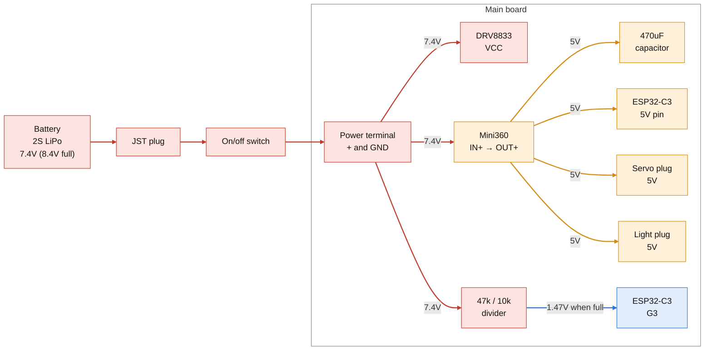
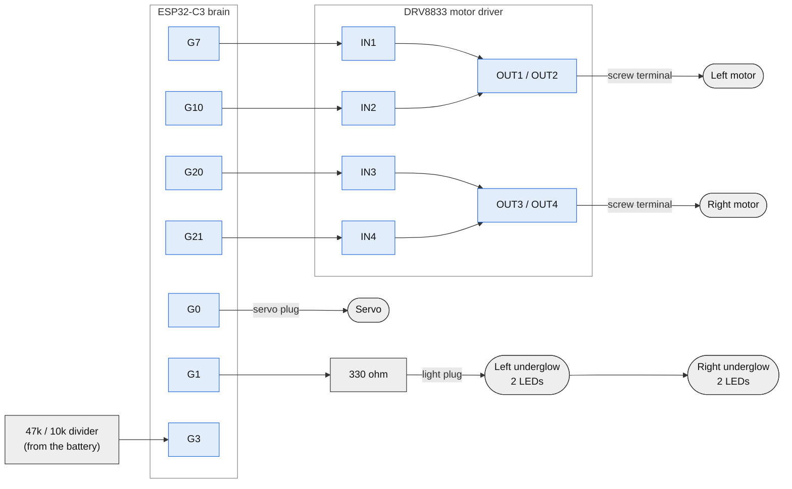
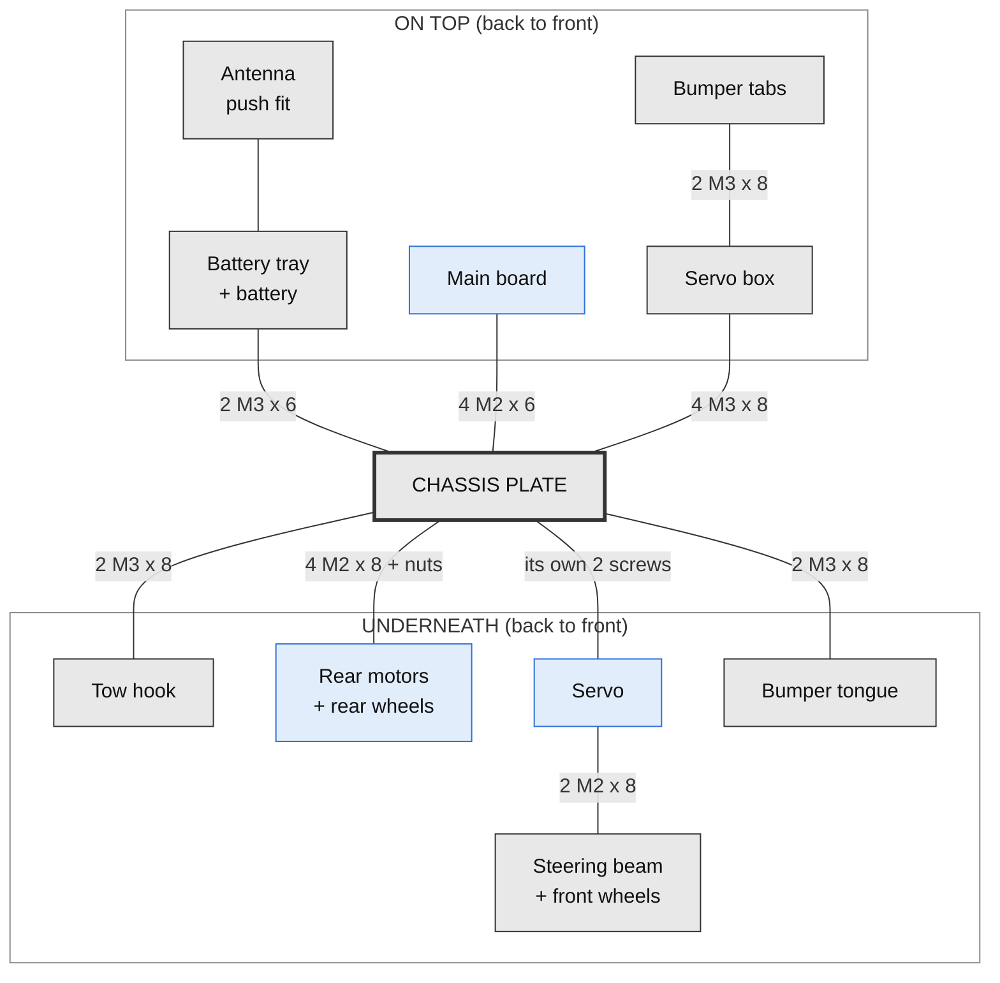
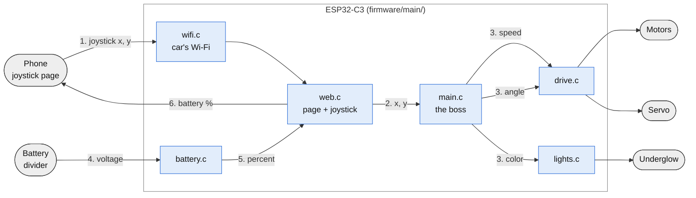

# Architecture

* How the car is built and wired, and how the code will run it.
* What to buy: [parts-list.md](parts-list.md). Drawings: [printed-parts](printed-parts/README.md).

## Contents

1. [Overview](#overview)
2. [Power Wiring](#power-wiring)
3. [Signal Wiring](#signal-wiring)
4. [The Main Board](#the-main-board)
5. [How The Parts Bolt Together](#how-the-parts-bolt-together)
6. [The Code](#the-code)
7. [Build Order](#build-order)
8. [Safety](#safety)
9. [Hard Parts](#hard-parts)
10. [File Reference](#file-reference)

## Overview

* A small RC car you drive from your phone. 202 mm long, about 5 mph.
* The brain (ESP32-C3) makes its own Wi-Fi. Join it, open the page, drive with the joystick. No app.
* Rear motors drive, a servo steers the front wheels.
* Underglow in any color, red when braking.
* Battery level shows on the phone.
* Every part unplugs from the main board, so any part can be swapped without soldering.
* 7 printed parts. Everything else is bought.
* Code is plain C on ESP-IDF.

## Power Wiring



* Red = battery voltage. Orange = 5V. Blue = signal.
* All grounds join on the main board.
* The motors are 6V, so the code never runs them past about 70%.
* The Mini360 gives up to 1.8A at 5V. The capacitor stops the brain from resetting when the motors or servo kick in.

## Signal Wiring



| Brain pin | Goes to | Job |
| --- | --- | --- |
| G0 | Servo plug | Steering |
| G1 | 330 ohm, then light plug | Underglow colors |
| G3 | Middle of the 47k / 10k divider | Battery level |
| G7, G10 | Motor driver IN1, IN2 | Left motor |
| G20, G21 | Motor driver IN3, IN4 | Right motor |

* G2, G8 and G9 stay empty. The brain checks them at startup, so using them can stop it from booting.

## The Main Board

* 5 x 7 cm perf board. Parts are soldered in and joined by bare wire underneath.
* Holes are counted from the back edge (0 to 23) and from the right edge (0 to 17). Seen from above:

```text
                       FRONT
      +------------------------------------------------------+
   23 |      [servo ]                                        |
   22 |                              +---------------------+ |
   21 |      [lights] [ 330  ]       |                     | |
   20 |                              |        brain        | |
   19 |                              |      ESP32-C3       | |
   18 |                     [C]      |    on 2 sockets     | |
   17 |                     [C]      |                     | |
   16 |                              +---------------------+ |
   15 |                                                      |
   14 |      +---------+                                     |
   13 |      |         |                                     |
   12 |      |   5V    |                                     |
   11 |      |  board  |                                     |
   10 |      |         |       +---------------+             |
    9 |      |         |       |               |             |
    8 |      +---------+       |     motor     |             |
    7 |                        |    driver     |             |
    6 |                        |               |             |
    5 |                        +---------------+             |
    4 |                                                      |
    3 |                                                      |
    2 |   [power ]             [L motor]   [R motor]         |
    1 |                                                      |
    0 |                                                      |
      +------------------------------------------------------+
       17 16 15 14 13 12 11 10 9  8  7  6  5  4  3  2  1  0
  left side             BACK              right side
```

| Part | Holes (from back, from right) |
| --- | --- |
| Screw terminals (row 2) | right motor 3 and 5, left motor 7 and 9, power + 14, GND 16 |
| Motor driver | rows 5 and 10, holes 4 to 9 |
| 5V board | IN- (8,12), IN+ (8,15), OUT- (14,12), OUT+ (14,15) |
| Capacitor (C) | + (17,10), - (18,10) |
| Brain sockets | rows 16 and 22, holes 0 to 7 |
| Battery resistors (under the brain) | 47k (19,3) to (19,5), 10k (20,5) to (20,3) |
| Light plug and 330 | plug row 21, holes 13 to 15. 330 from (21,10) to (21,12) |
| Servo plug | row 23, holes 13 to 15, pins point forward |

* Wires underneath never cross.
* Two wires run on top: 5V to the servo and light plugs, and battery + to the battery resistors.
* Every wire is in the 3D model: `blender/rc_car.blend`, collection "Wires".

## How The Parts Bolt Together



* Grey = printed. Blue = bought.
* The servo shaft is the steering pivot. The beam turns with the servo arm, 22 degrees each way.
* Front wheels spin on M3 x 30 bolts screwed into the beam ends. Rear wheels push onto the motor shafts.

| Screws | Count | Where |
| --- | --- | --- |
| M3 x 8 | 10 | servo box 4, bumper 4, tow hook 2 |
| M3 x 6 | 2 | battery tray |
| M3 x 30 + 4 washers | 2 | front wheels |
| M2 x 8 | 6 | motor brackets 4 (with nuts), servo arm 2 |
| M2 x 6 | 4 | main board |
| Inserts | 14 | plate 6 (3 mm long), servo box 6 (6 mm), beam 2 (8 mm) |

## The Code

* Plain C on ESP-IDF, target esp32c3. The project is in `firmware/`. All code goes in `firmware/main/`.
* So far only `main.c` exists, and it just blinks the onboard LED.

| File | Job |
| --- | --- |
| `main.c` | Starts everything. Stops the car if the phone goes quiet. |
| `wifi.c` | Makes the car's Wi-Fi. |
| `web.c` | Serves the joystick page and reads the joystick. |
| `drive.c` | Motor speed and steering angle (PWM). |
| `battery.c` | Reads G3 and turns it into a percent. |
| `lights.c` | Underglow colors. Red when braking. |



* Blue = code files. Grey = things outside the code.
* Steps 1 to 6 repeat about 20 times a second.
* If `main.c` hears nothing from the phone for half a second, it stops the motors.

## Build Order

1. **Code setup.** Install ESP-IDF, set the target to esp32c3, run hello world.
2. **Breadboard test.** Add one part at a time with its code: Wi-Fi page, servo, motors, 5V board, battery reading, underglow, auto stop.
3. **Print and test fit.** Plate first, then the beam. Melt in the inserts.
4. **Solder the main board.** Check 5V with the multimeter before the brain goes in.
5. **Put it together.** Motors, servo, beam, wheels, tray, servo box, bumper, hook.
6. **Wire it up.** Motors, battery, switch, servo, lights.
7. **Drive it.**

## Safety

* **USB or battery, never both.** Turn the car off before plugging in USB.
* **Check 5V first.** Measure the 5V board before the brain goes in.
* **No power while soldering.** Unplug the battery.
* **Charge with its own charger.** Stop driving when the phone says the battery is low (about 6.6V).

## Hard Parts

| Problem | Plan |
| --- | --- |
| G21 is also a debug pin, so the right motor may twitch at power on. | Turn on with the wheels off the ground. Move the pin if it bothers us. |
| The brain's signal is 3.3V and the LEDs want 5V. | Usually works. If they flicker, add a level shifter. |
| Screw terminal pins may not fit the perf board holes. | Drill those holes with a 1.2 mm bit. |
| The plate posts assume the board's corner holes are 2.8 mm from each edge. | Measure the real board before printing the plate. |
| The light wires hang under the plate. | Tape or zip tie them flat. |

## File Reference

```text
rc-car/
├── README.md              front page on GitHub
├── blender/
│   ├── rc_car.blend       the 3D model
│   └── scripts/
│       ├── build_car.py   builds the 3D model and checks it
│       ├── make_sheets.py makes the drawing PDFs
│       └── render_part.py makes the part pictures
├── firmware/              the car's code (ESP-IDF project)
│   ├── CMakeLists.txt     names the project
│   ├── sdkconfig          chip settings (change with idf.py menuconfig)
│   └── main/
│       ├── CMakeLists.txt lists the .c files to build
│       └── main.c         starts everything
└── docs/
    ├── architecture.md    this file
    ├── parts-list.md      what to buy (kept out of git for now)
    └── printed-parts/     one folder per part: drawing PDF and pictures
```

```sh
# build the model and check it (must show 0 everywhere)
Blender --background --factory-startup --python blender/scripts/build_car.py -- --check

# make all drawings
uv run --with matplotlib python blender/scripts/make_sheets.py

# make one picture
Blender --background blender/rc_car.blend --python blender/scripts/render_part.py -- --part "Chassis plate" --out part.png
```

* `Blender` is `/Applications/Blender.app/Contents/MacOS/Blender` on a Mac.
